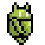
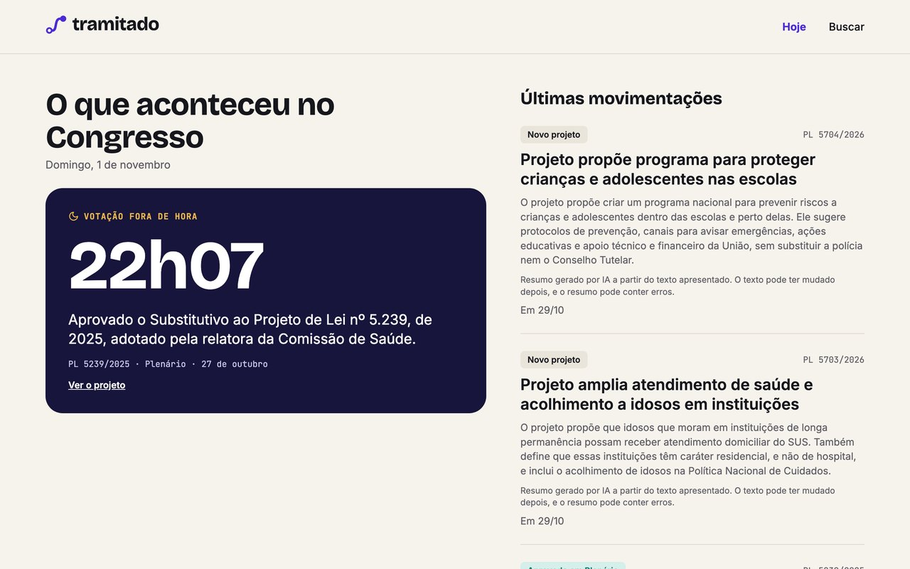

<h2>Oi, meu nome é Ivan </h2>

<p><em>Desenvolvedor Android em São Paulo, construindo produtos do app ao site, e entusiasta de música.</em></p>

### Um pouco sobre mim

```kotlin
val ivan = Dev(
    baseadoEm = "São Paulo, Brasil",
    codigo = listOf("Kotlin", "TypeScript"),
    ferramentas = listOf("Android", "Next.js", "Supabase", "GitHub Actions"),
    interesses = listOf("música"),
)
```

### Últimos 12 meses 

| 556 | 327 | 221 | 7 |
|:---:|:---:|:---:|:---:|
| contribuições | commits | PRs com merge | repositórios novos |

A maior parte desse trabalho está em repositórios privados: 325 dos 327 commits.
Em outubro de 2026 foram 96 PRs abertos, o mês mais intenso do período.

`Kotlin 88%` `TypeScript 11%` `HTML 1%`

<sub>Dados da API do GitHub, de 01/11/2025 a 01/11/2026. Só totais agregados. Linguagens: commits do período, pela linguagem principal de cada repositório.</sub>

### Em destaque

<a href="https://tramitado.vercel.app"></a>

**[Tramitado](https://tramitado.vercel.app)**: site cívico que reúne dados do Legislativo brasileiro e explica os projetos em linguagem simples. Feito com Next.js, Supabase e GitHub Actions.

<a href="https://chelengo-lengo.vercel.app"></a>

**[Chelengo Lengo](https://chelengo-lengo.vercel.app)**: karaokê com banda ao vivo. O público pede a música pelo celular, a letra aparece no telão e os músicos veem a cifra, tudo sincronizado. Feito com React e Supabase.

### Vamos conversar

[LinkedIn](https://www.linkedin.com/in/ivan-alineri/) · [E-mail](mailto:ivancrizza@gmail.com)

<details>
<summary><sub>Créditos das animações</sub></summary>
<br>
<sub>Robô Android: art by <a href="https://opengameart.org/users/dezrasdragons">DezrasDragons</a>, based on an original character design by <a href="https://opengameart.org/users/jason-em">Jason-Em</a> and the Android robot (<a href="https://opengameart.org/content/android-robot-animated">fonte</a>, <a href="https://creativecommons.org/licenses/by/3.0/">CC-BY 3.0</a>). The Android robot is modified from work created and shared by Google and used according to terms described in the Creative Commons 3.0 Attribution License. Quadros convertidos em GIF e ampliados.</sub>
<br><br>
<sub>Computador: <a href="https://nightspore.itch.io/four-retro-computer-sprites">Four Retro Computer Sprites</a>, de Nightspore, ampliado.</sub>
</details>
